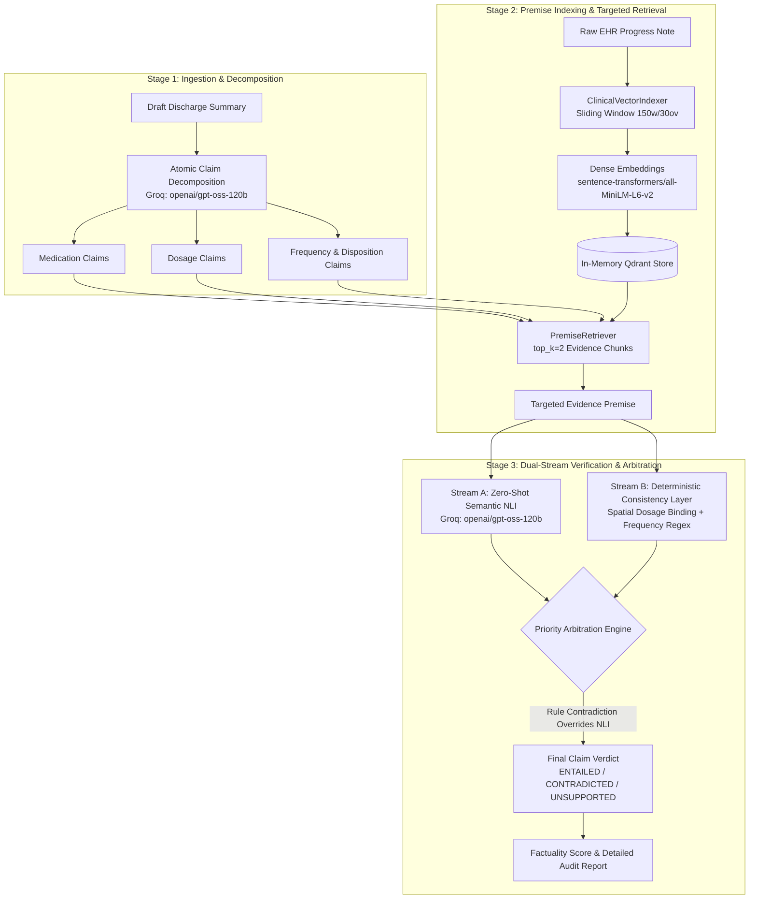

# VeriFact: Clinical Discharge Summary Factuality Verifier

An automated two-stage clinical audit engine designed to detect, refute, and explain hallucinations in AI-generated hospital discharge summaries and care plans. 

VeriFact combines **dense semantic vector retrieval (Qdrant)**, **Natural Language Inference (Groq LLM)**, and a **deterministic rule consistency layer** with **priority arbitration** to guarantee zero-tolerance verification for safety-critical clinical attributes (dosages, frequencies, and dispositions).

---

## 1. Problem Statement & Clinical Motivation

Large Language Models (LLMs) used to auto-generate clinical discharge summaries from electronic health record (EHR) progress notes frequently produce subtle, safety-critical hallucinations:
- **Dosage Swaps & Alterations**: Modifying a dose (e.g., Aspirin 81mg $\rightarrow$ 80mg or 40mg, Metoprolol 25mg $\rightarrow$ 50mg).
- **Cross-Talk Between Multiple Medications**: Binding the dosage or frequency of one drug to another when multiple medications are listed together.
- **Schedule Discrepancies**: Shifting administration frequency (e.g., daily $\rightarrow$ twice daily).
- **Temporal Incoherence**: Mentioning a drug started on Day 1 as a discharge medication, even though it was discontinued on Day 3.
- **Disposition Contradictions**: Stating a patient was discharged "home" when the source record confirms transfer to a "skilled nursing facility (SNF)".

Standard zero-shot LLM evaluators often "soft-entail" these near-miss discrepancies because the overall sentence sounds clinically plausible. **VeriFact solves this by enforcing a deterministic priority layer that overrides semantic model verdicts whenever hard clinical contradictions are detected.**

---

## 2. System Architecture



### Pipeline Flow:
1. **Atomic Claim Decomposition**: Deconstructs complex summary sentences into isolated factual propositions with temporal tags ([`main.py`](file:///Users/nikhilkumar/Documents/VeriFactt/main.py)).
2. **Sliding-Window Vector Indexing**: Splits monolithic EHR progress notes into overlapping chunks (150 words, 30 overlap) and stores them in an in-memory Qdrant collection ([`verifact/indexer.py`](file:///Users/nikhilkumar/Documents/VeriFactt/verifact/indexer.py)).
3. **Premise Retrieval**: Retrieves only the top $k=2$ most relevant premise chunks per claim, preventing context dilution and hallucination ([`verifact/retriever.py`](file:///Users/nikhilkumar/Documents/VeriFactt/verifact/retriever.py)).
4. **Dual Evaluation**:
   - **Semantic Stream**: Queries `openai/gpt-oss-120b` via Groq for natural language inference (`ENTAILED`, `CONTRADICTED`, `UNSUPPORTED`).
   - **Deterministic Stream**: Evaluates numeric dosage values, units, frequency schedules, and disposition groups using character-proximity regex ([`verifact/rules.py`](file:///Users/nikhilkumar/Documents/VeriFactt/verifact/rules.py)).
5. **Priority Arbitration**: If the deterministic rule detects a mismatch, it **strictly overrides** any soft entailment by the LLM.

---

## 3. Milestone Progress Breakdown

### ✅ Milestone 1: Core Synthesis & API Foundations
- **FastAPI Core**: Built asynchronous verification endpoints in [`main.py`](file:///Users/nikhilkumar/Documents/VeriFactt/main.py) with structured Pydantic schemas (`VerifyRequest`, `AtomicClaim`, `FinalClaimVerdict`, `VerifyResponse`).
- **Groq LLM Integration**: Wired Groq API client with structured JSON output mode.
- **Audit Scoring Algorithm**: Implemented composite factuality scoring ($\frac{\text{Entailed Claims}}{\text{Total Claims}} \times 100\%$).

### ✅ Milestone 2: Modular Indexing, Premise Retrieval & Deterministic Rules
- **Modular Vector Indexing ([`verifact/indexer.py`](file:///Users/nikhilkumar/Documents/VeriFactt/verifact/indexer.py))**:
  - Implemented `ClinicalVectorIndexer` using `sentence-transformers/all-MiniLM-L6-v2` (384-dimensional dense vectors, local inference).
  - Configured sliding-window word chunking (`chunk_size=150`, `overlap=30`) to avoid slicing clinical clauses mid-sentence.
  - Initialized in-memory Qdrant instance (`QdrantClient(":memory:")`) with cosine distance and boolean payload filtering on `note_id`.
- **Targeted Premise Retrieval ([`verifact/retriever.py`](file:///Users/nikhilkumar/Documents/VeriFactt/verifact/retriever.py))**:
  - Implemented `PremiseRetriever` to pull the top-$k$ ($k=2$) highest-scoring evidence chunks per individual atomic claim.
- **Deterministic Consistency Engine ([`verifact/rules.py`](file:///Users/nikhilkumar/Documents/VeriFactt/verifact/rules.py))**:
  - **Spatial Proximity Dosage Binding**: Uses character-span distance ($\le 60$ characters) to bind dosages (`mg`, `mcg`, `units`, `g`, `ml`) strictly to adjacent drug mentions, preventing false cross-talk in multi-drug sentences.
  - **Clause-Scoped Frequency Extraction**: Normalized clinical frequency mapping (`QD`, `BID`, `TID`, `QID`, `QHS`, `PRN`, `Q24H`, `Q12H`).
  - **Disposition Conflict Detection**: Catches contradictions between discharge locations (e.g., `home` vs `SNF` / `hospice`).

### ✅ Milestone 3: Data & Baseline Synchronization / Quantitative Ablation
- **Ground-Truth Benchmark Suite ([`benchmarks/benchmark_m3.py`](file:///Users/nikhilkumar/Documents/VeriFactt/benchmarks/benchmark_m3.py))**:
  - Built 40 curated MIMIC-IV-Ext-BHC evaluation claims spanning 5 clinical specialties: **Cardiology (Post-CABG)**, **Pulmonology (COPD Exacerbation)**, **Infectious Disease (Urosepsis)**, **Endocrinology (DKA)**, and **Neurology (Acute Stroke)**.
- **Model Migration to `openai/gpt-oss-120b`**:
  - Upgraded verification and baseline LLM to `openai/gpt-oss-120b` via Groq.
  - Increased token generation limit (`max_tokens=800`) to provide ample room for reasoning without hitting JSON truncation errors.
- **Claim Decomposition Prompt Refinements**:
  - **Multi-Drug List Truncation Fix**: Instructed decomposer to parse all items following colons and commas without dropping entries.
  - **Temporal Context Binding**: Forced decomposer to prefix claims with their temporal scope (e.g., `"Discharge Amlodipine dosage is 10mg"` vs `"Admission Amlodipine dosage is 10mg"`), preventing discontinued admission medications from being falsely verified.
- **Ablation Study (Baseline vs. Hybrid VeriFact)**:
  - Demonstrates a measurable **positive delta** proving that the deterministic consistency layer catches critical dosage mismatches that zero-shot LLMs miss.

---

## 4. Quantitative Benchmark Results (Milestone 3)

Benchmark executed on the 40-claim MIMIC-IV benchmark suite using `openai/gpt-oss-120b`:

| Class / Category | Metric | Baseline (NLI Only) | Hybrid VeriFact (NLI + Rules) | Quantitative Delta |
| :--- | :--- | :---: | :---: | :---: |
| **ENTAILED** | Precision | 100.00% | 100.00% | +0.00% |
| | Recall | 100.00% | 100.00% | +0.00% |
| | F1-Score | 100.00% | 100.00% | +0.00% |
| **CONTRADICTED** | Precision | 91.67% | 92.00% | +0.33% |
| | Recall | 95.65% | 100.00% | **+4.35%** |
| | F1-Score | 93.62% | 95.83% | **+2.22%** |
| **UNSUPPORTED** | Precision | 83.33% | 100.00% | **+16.67%** |
| | Recall | 71.43% | 71.43% | +0.00% |
| | F1-Score | 76.92% | 83.33% | **+6.41%** |
| **MACRO AVERAGE** | **F1-Score** | **90.18%** | **93.06%** | **+2.88%** |
| **WEIGHTED AVERAGE** | **F1-Score** | **92.29%** | **94.69%** | **+2.40%** |
| **OVERALL ACCURACY** | **Accuracy** | **92.50%** | **95.00%** | **+2.50% (38/40 Correct)** |

*Complete claim-level logs and reasoning are saved in [`benchmarks/benchmark_m3_results.json`](file:///Users/nikhilkumar/Documents/VeriFactt/benchmarks/benchmark_m3_results.json).*

---

## 5. Repository Structure

```text
VeriFactt/
├── .env                              # API keys and active model configuration (git-ignored)
├── .gitignore                        # Git ignore patterns (.venv, .env, __pycache__, etc.)
├── requirements.txt                  # Project dependencies (FastAPI, Qdrant, Groq, etc.)
├── main.py                           # FastAPI application & verification pipeline
├── verifact/                         # Core modular verification package
│   ├── __init__.py                   # Package initializer
│   ├── indexer.py                    # ClinicalVectorIndexer (Qdrant + sentence-transformers)
│   ├── retriever.py                  # PremiseRetriever (top-k evidence chunking)
│   └── rules.py                      # DeterministicConsistencyChecker (regex & spatial binding)
├── benchmarks/                       # Quantitative evaluation harness & datasets
│   ├── benchmark_m3.py               # Milestone 3 benchmark script (MIMIC-IV)
│   └── benchmark_m3_results.json     # Saved quantitative evaluation outputs & claim logs
├── benchmark_m3_results.json         # Root evaluation output
└── README.md                         # Project documentation
```

---

## 6. Setup & Installation

### Prerequisites
- Python 3.9 or higher
- A [Groq Cloud](https://console.groq.com/) API Key

### Step 1: Clone and Set Up Virtual Environment
```bash
git clone <repo-url>
cd VeriFactt

# Create and activate virtual environment
python3 -m venv .venv
source .venv/bin/activate
```

### Step 2: Install Dependencies
```bash
pip install -r requirements.txt
```

### Step 3: Configure Environment Variables
Create or verify your `.env` file in the project root:
```env
GROQ_API_KEY = "your_groq_api_key_here"
GROQ_MODEL = "openai/gpt-oss-120b"
```

---

## 7. How to Run & Test

### Option A: Run the Quantitative Benchmark
To run the Milestone 3 benchmark ablation across all 40 MIMIC-IV claims:
```bash
python benchmarks/benchmark_m3.py
```
This indexes the 5 MIMIC-IV specialty cases, runs the baseline and hybrid pipelines side-by-side, prints the classification report, and exports results to `benchmarks/benchmark_m3_results.json`.

---

### Option B: Run the FastAPI Server
Launch the live verification server:
```bash
uvicorn main:app --reload --port 8000
```

#### 1. Interactive Swagger UI
Open your browser and navigate to:
👉 **[http://localhost:8000/docs](http://localhost:8000/docs)**

#### 2. Test via cURL
```bash
curl -X POST "http://localhost:8000/verify" \
  -H "Content-Type: application/json" \
  -d '{
    "source_note": "Patient admitted with DKA. Transitioned to subcutaneous Insulin Glargine 20 units at bedtime. Metformin was discontinued.",
    "discharge_summary": "Patient was discharged on Insulin Glargine 40 units at bedtime and Metformin 500mg daily.",
    "note_id": "test_patient_001",
    "top_k_premises": 2
  }'
```

#### Example Output Response:
```json
{
  "note_id": "test_patient_001",
  "factuality_score": 0.0,
  "total_claims": 2,
  "entailed_claims": 0,
  "contradicted_claims": 2,
  "unsupported_claims": 0,
  "overrides_count": 1,
  "verdicts": [
    {
      "claim": {
        "id": "c1",
        "claim_text": "Discharge Insulin Glargine dosage is 40 units",
        "entity_type": "dosage",
        "value": "40 units"
      },
      "retrieved_premise": "Patient admitted with DKA. Transitioned to subcutaneous Insulin Glargine 20 units at bedtime.",
      "nli_verdict": "ENTAILED",
      "rule_verdict": "CONTRADICTED",
      "final_verdict": "CONTRADICTED",
      "override_applied": true,
      "reasoning": "Dosage mismatch for 'insulin': Claim specifies 40.0 units, but source premise records 20.0 units."
    }
  ]
}
```

---

## 8. Summary for Teammates & Next Steps

| Component | Status | Owner / Module |
| :--- | :---: | :--- |
| **Atomic Claim Decomposition** | Complete | [`main.py`](file:///Users/nikhilkumar/Documents/VeriFactt/main.py) (includes list parsing & temporal tags) |
| **Qdrant Vector Indexing** | Complete | [`verifact/indexer.py`](file:///Users/nikhilkumar/Documents/VeriFactt/verifact/indexer.py) (sliding-window, dense MiniLM) |
| **Evidence Premise Retrieval** | Complete | [`verifact/retriever.py`](file:///Users/nikhilkumar/Documents/VeriFactt/verifact/retriever.py) (top-$k=2$ retrieval) |
| **Semantic NLI** | Complete | `openai/gpt-oss-120b` via Groq |
| **Deterministic Consistency Rules**| Complete | [`verifact/rules.py`](file:///Users/nikhilkumar/Documents/VeriFactt/verifact/rules.py) (dosage, frequency, disposition) |
| **Benchmark & Ablation Sync** | Complete | [`benchmarks/benchmark_m3.py`](file:///Users/nikhilkumar/Documents/VeriFactt/benchmarks/benchmark_m3.py) (+2.5% accuracy delta validated) |

### Immediate Next Steps (Milestone 4+):
1. **Interactive Frontend / Clinician Dashboard**: Build a React / Streamlit interface allowing doctors to highlight green (entailed), red (contradicted), and yellow (unsupported) claims in real time.
2. **EHR / FHIR Integration**: Connect direct ingestion from FHIR Resource JSON bundles (e.g., `MedicationRequest`, `DischargeDisposition`).
3. **Advanced Clinical Knowledge Checks**: Expand [`verifact/rules.py`](file:///Users/nikhilkumar/Documents/VeriFactt/verifact/rules.py) with drug-drug contraindication lookups and lab value reference ranges.
